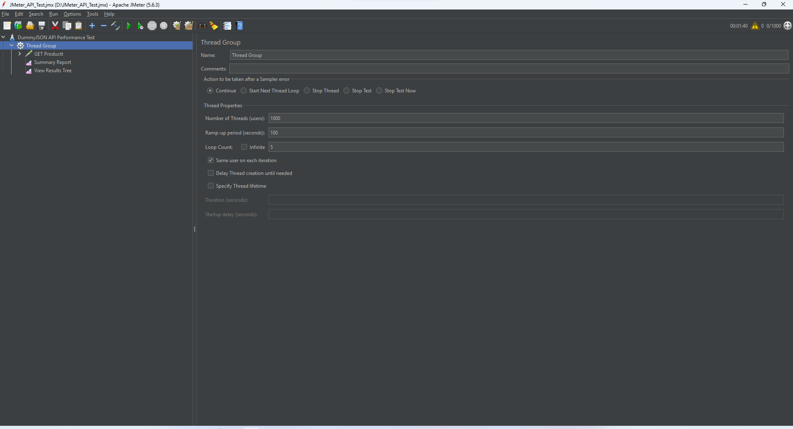
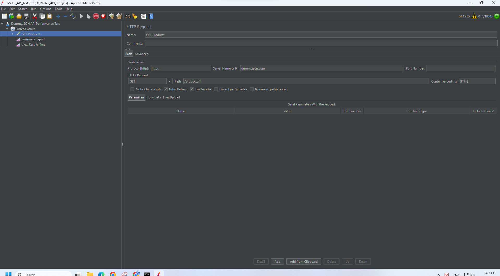
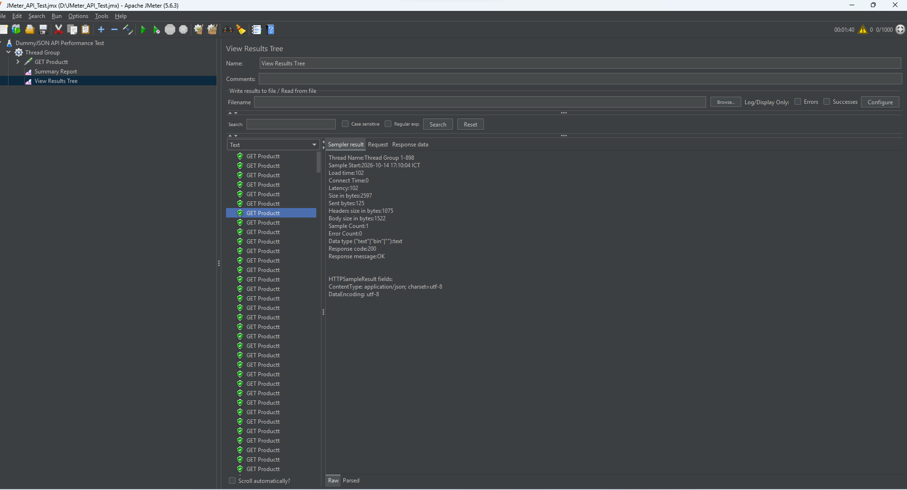
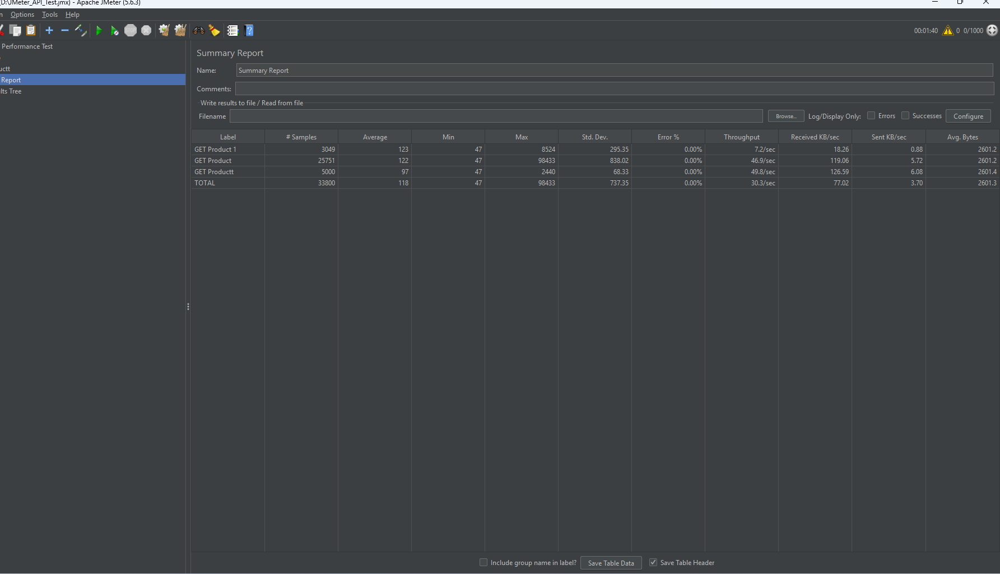

# BÁO CÁO KIỂM THỬ API BẰNG APACHE JMETER

## 1. Giới thiệu

Apache JMeter là công cụ mã nguồn mở dùng để kiểm thử tải và đo thời gian phản hồi của API. Bài thực hành này tập trung vào **một cấu hình: 1.000 threads, Ramp-up 100 giây**, gửi HTTP GET đến API DummyJSON và quan sát kết quả bằng Summary Report, View Results Tree.

## 2. Công cụ và đối tượng kiểm thử

| Thành phần | Thông tin |
|---|---|
| Công cụ | Apache JMeter 5.6.3 |
| API | DummyJSON |
| Endpoint | `https://dummyjson.com/products/1` |
| Phương thức HTTP | GET |
| Phản hồi mong đợi | HTTP 200 OK |

Kết quả phụ thuộc vào máy chạy, đường truyền và tình trạng API tại thời điểm đo.

## 3. Cấu hình kiểm thử 1.000 threads – 100 giây

| Thông số | Giá trị |
|---|---:|
| Number of Threads (Users) | **1.000** |
| Ramp-up Period | **100 giây** |
| Loop Count | **5** |
| Số lượt HTTP Request dự kiến | **5.000** |

JMeter khởi tạo người dùng ảo theo thời gian Ramp-up (trung bình khoảng 10 threads/giây). Với một HTTP Request ở mỗi vòng, số mẫu dự kiến là **1.000 × 5 = 5.000** nếu các vòng lặp đều hoàn thành.

**Hình 1 — Cấu hình Thread Group:**

**Hình 2 — Cấu hình HTTP Request:**

> Lưu ý: File `JMeter_API_Test.jmx` hiện có trên repo vẫn chứa cấu hình ban đầu 10 threads. Để tái lập chính xác phép thử này, cần lưu và tải lên bản JMX đã cấu hình 1.000 threads / 100 giây.

## 4. Kết quả thực nghiệm

### 4.1. Trạng thái sau khi chạy

Trong ảnh JMeter đã chạy xong, góc trên bên phải hiển thị **0/1000** threads đang hoạt động và thời gian hiển thị **00:01:40**. Một request được kiểm tra trong View Results Tree trả về **Response code: 200** và **Response message: OK**.

**Hình 3 — View Results Tree:**

### 4.2. Số liệu từ Summary Report

Ảnh Summary Report đã chia sẻ trước đó có nhiều nhãn sampler và dòng TOTAL cộng dồn kết quả từ nhiều lần chạy. Trong đó, dòng **GET Producttt** ghi nhận **5.000 Samples**, khớp với số lượt request dự kiến của cấu hình 1.000 users × 5 loops.

| Chỉ số ở dòng GET Producttt | Giá trị |
|---|---:|
| # Samples | **5.000** |
| Average | **97 ms** |
| Min | **47 ms** |
| Max | **2.440 ms** |
| Std. Dev. | **68,33 ms** |
| Error % | **0,00%** |
| Throughput | **49,8 request/giây** |

**Lưu ý về tính chính xác:** Chưa có tệp kết quả riêng (`.jtl`) hoặc xác nhận tên sampler để chứng minh chắc chắn dòng `GET Producttt` chỉ thuộc lần chạy 1.000 threads. Vì vậy bảng trên trình bày đúng **số liệu quan sát được của dòng GET Producttt**, không khẳng định là số liệu đã tách độc lập.

Ảnh Summary Report còn cho thấy tổng cộng **33.800 Samples**, nhưng đây là số mẫu tích lũy nhiều lượt chạy, **không phải kết quả riêng** của thử nghiệm 1.000 threads / 100 giây.

**Hình 4 — Ảnh minh họa bổ sung đã tải lên:**

> Nếu `get.png` không phải ảnh Summary Report, cần tải thêm ảnh Summary Report thực tế. Ảnh Summary Report được sử dụng làm nguồn cho số liệu trong bảng trên là ảnh đã cung cấp trong cuộc trò chuyện.

### 4.3. Nhận xét

- **Số lượng mẫu:** Dòng `GET Producttt` ghi nhận 5.000 samples, bằng số request dự kiến theo cấu hình.
- **Tỷ lệ lỗi:** Dòng này có `Error % = 0,00%` và mẫu quan sát trong View Results Tree trả về HTTP 200 OK.
- **Thời gian phản hồi:** Trung bình **97 ms**, nhanh nhất **47 ms**, chậm nhất **2.440 ms**; có chênh lệch giữa các request.
- **Thông lượng:** **49,8 request/giây** theo dòng `GET Producttt`. Không nên suy diễn đây là năng lực tối đa của API vì chưa có kiểm thử độc lập và kiểm soát môi trường.

## 5. Kết luận

Đã thực hành Apache JMeter với cấu hình **1.000 threads, Ramp-up 100 giây, Loop Count 5** và ghi nhận các phản hồi HTTP 200 OK. Dòng thống kê có 5.000 samples cho thấy **Average 97 ms, Error 0,00%, Throughput 49,8 request/giây**. Tuy nhiên, Summary Report có dữ liệu tích lũy nhiều lượt chạy; cần xuất kết quả riêng hoặc xác nhận nhãn sampler trước khi đưa ra kết luận hiệu năng có tính đối chiếu.

## 6. Tài liệu tham khảo

- [Apache JMeter](https://jmeter.apache.org/)
- [JMeter Getting Started](https://jmeter.apache.org/usermanual/get-started.html)
- [DummyJSON](https://dummyjson.com/)
